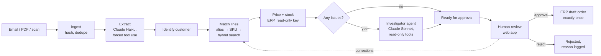

# orderdesk

**An AI order desk for wholesale distributors.** Customers email purchase orders as PDFs, scans
and free text. orderdesk reads them, matches every line to the catalogue, checks price and stock
in the ERP, has an agent investigate anything uncertain, and puts a draft order in front of a
human. Nothing reaches the ERP until a person approves it.

| | |
| --- | --- |
| Extraction accuracy (field-level, 8-document eval set) | **99.5%** |
| Catalogue matching: top-1 / recall@5 (28 lines) | **96.4% / 100%** |
| LLM cost per order: extraction / agent investigation | **~0.05p / ~3.5p** |
| Tests | **152**, run in CI against a real Postgres |

## How it works



1. **Ingest** emails and PDFs. A SHA-256 content hash makes re-delivered files a no-op.
2. **Extract** with Claude using forced tool use against a Pydantic schema, so the output is
   always valid structured data. Scanned PDFs go to the model as images.
3. **Match** each line: the customer's own codes and learned aliases first, then exact SKU, then
   hybrid search (pgvector embeddings plus Postgres full-text, merged with reciprocal rank fusion).
4. **Route.** Ten checks (unknown customer, account on hold, amendment, possible duplicate,
   uncertain match, unit mismatch, stock and more) decide whether an order is clean or needs a look.
5. **Investigate.** A bounded agent loop (max 8 steps, inside a cost budget) uses read-only tools to
   resolve what it can and recommend what a human should do.
6. **Approve.** A reviewer edits, approves or rejects in the web app. Approval creates the ERP
   draft with an idempotency key, so double-clicks, two reviewers or a crash-and-retry still give
   one order. Corrections become customer aliases, so the system improves with use.

## Design decisions worth reading

- **Evals before prompts.** Every prompt change runs against a labelled eval set; CI fails the
  build if extraction drops below 95% or matching below its thresholds.
- **Code for rules, the model for judgement.** Null-like strings, unit names and quantity checks
  are validated in code; the LLM only does what code can't.
- **The agent can't do damage.** It holds a read-only ERP key and has no tools that write. The
  customer's document is wrapped as untrusted input; a prompt-injection email in the sample set is
  caught and recommended for rejection.
- **Cheap by routing.** Clean orders never touch the expensive agent model.
- **Every LLM call is traced** (purpose, tokens, cost, latency, errors) and visible per order and
  on an ops page. Traces are written on a separate connection so failed calls survive rollbacks.
- **Security in depth.** scrypt-hashed passwords, revocable server-side sessions, CSRF tokens,
  login throttling, a strict Content-Security-Policy, auto-escaped templates.

## Things that broke, and what they taught me

- **A fake 98% score.** An SDK parameter error made every extraction fail silently, and the scorer
  graded stale files from a previous run. Fix: clear outputs first, exit non-zero on any failure,
  count missing outputs as wrong.
- **"No.8" didn't match.** Postgres' tokeniser treated `No.8` as one token. Fixed by splitting on
  punctuation in the generated search column.
- **A scan with no email address** made a real customer look unknown. Fixed with a company-name
  fallback that flags the weaker evidence for review.
- **The agent called an original order a duplicate of its own amendment**, because its history
  tool didn't say which orders were amendments. When an agent is wrong, check what its tools showed
  it before blaming the model.
- **The live line check passed its test but was blank in the browser**: the test sent `sku`, the
  browser sends `sku_1`.

## Run it

**Everything in containers** (needs Docker):

```bash
docker compose --profile app up --build
```

Open http://localhost:8000 and log in as `demo@orderdesk.app` / `try-orderdesk-demo`.

**For development:**

```bash
uv sync
docker compose up -d db
cp .env.example .env               # add your ANTHROPIC_API_KEY
uv run python -m orderdesk.catalogue
uv run uvicorn orderdesk.erp_sim.app:create_app --factory --port 8100   # terminal 1
uv run python -m orderdesk.pipeline                                     # extract + route
uv run python -m orderdesk.agent                                        # investigate
uv run python -m orderdesk.auth add-user you@example.com
uv run uvicorn orderdesk.web.app:create_app --factory --port 8000 --reload
```

**Tests and evals:**

```bash
uv run pytest -q
uv run python evals/score_matching.py
uv run python scratch/extract_inbox.py && uv run python evals/score_extraction.py
```

Deploying a public demo: see [DEPLOY.md](DEPLOY.md).

## Stack

Python 3.12 · uv · Pydantic v2 · Claude API (Haiku for extraction, Sonnet for the agent) ·
Postgres 17 + pgvector · fastembed · FastAPI · Jinja + HTMX · httpx · pytest · ruff ·
Docker · GitHub Actions

The ERP is simulated (FastAPI + SQLite, with optional fault injection) and all customers and
orders are fictional.
